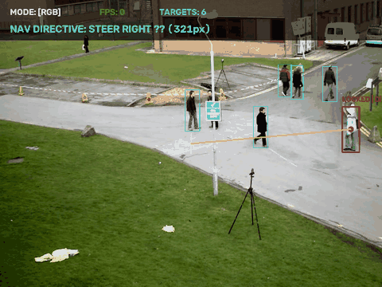
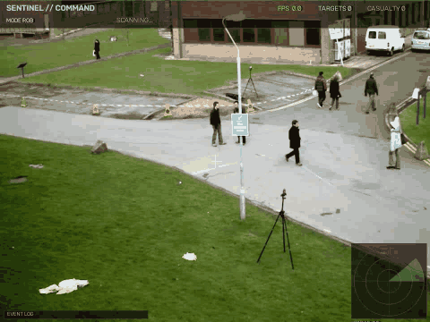
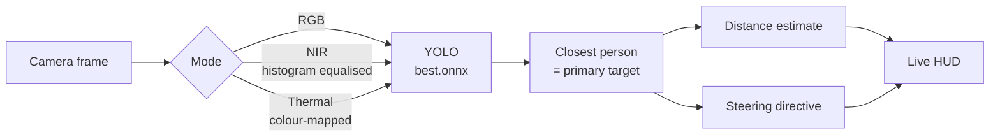

<div align="center">



**A portable AI scanner for search and rescue: real-time, occlusion-aware human detection across RGB, near-infrared and thermal views.**


</div>

---

<div align="center">



<sub>Real run of <code>tactical_dashboard.py</code> with the repo's <code>best.onnx</code> on public sample pedestrian footage (RGB → simulated NIR → simulated thermal).</sub>

</div>

---

## 🚀 Sentinel Command (presentation HUD)

`sentinel_command.py` wraps the **same `best.onnx`** (unchanged) in a much richer live interface.

<div align="center">



<sub>Real run on public sample pedestrian footage: tracking, trails, heatmap, radar, event log, then the 2x2 tri-spectral wall.</sub>

</div>

| | |
|---|---|
| 🔢 **Multi-target tracking** | Persistent IDs, motion trails and smoothed boxes across frames |
| 🆘 **Casualty logic** | A person who stays still **and lies down** (wide, low box) for 3 s is flagged as a possible casualty, with a flashing alert, a priority directive and a red radar blip. Upright people who stop are only marked "holding" |
| 📡 **Radar** | Top-down bearing and range blips for every tracked person |
| 🌗 **Four imaging modes** | RGB, green night-vision NIR (CLAHE, noise, vignette), inferno thermal, and thermal + edge fusion |
| 🧱 **Tri-spectral wall** | Press `v` for all four views at once, with one inference shared across them |
| 🔥 **Density heatmap** | Where people have been, decaying over time (`h`) |
| 🎬 **Record and snapshot** | `r` records an MP4, `s` saves a PNG, `a` auto-cycles the modes for a hands-free demo |

```bash
pip install opencv-python numpy onnxruntime        # ultralytics is optional; it is used if installed
python sentinel_command.py                          # webcam
python sentinel_command.py --source clip.mp4 --auto --heat
```

Keys: `1` RGB · `2` NIR · `3` thermal · `4` fusion · `v` wall · `h` heatmap · `a` auto-cycle · `r` record · `s` snapshot · `q` quit.

The NIR and thermal views are simulated from the RGB feed, and distance is a pinhole estimate from box height, so treat ranges as approximate. The casualty cue depends on box shape, so it needs a clear side or oblique view.

---

## 🎯 Why Sentinel

In disaster zones people are partly buried, hidden behind debris or lying in the dark. A detector tuned for clean street scenes misses them. Sentinel trains a YOLO11n model (the shipped `best.onnx` detects three classes: person, face and hand) with tooling for **CrowdHuman**, a dataset full of heavily overlapping and partially hidden people, and wraps it in a handheld-style heads-up display that works across imaging modes.

---

## ✨ Features

| | |
|---|---|
| 👁️ **Occlusion-aware detection** | Detects person, face and hand; the repo includes CrowdHuman tooling for crowded, partially hidden scenes |
| 🌗 **Multi-spectral modes** | Switch live between **RGB**, simulated **NIR** and simulated **Thermal** (false-colour) |
| 📏 **Range estimate** | Distance to the nearest person from bounding-box height (pinhole model, 1.7 m reference height) |
| 🎯 **Targeting HUD** | Crosshair, target lock on the closest person, and a steering directive: steer left, steer right, approach, or stop |
| ⚡ **Fast inference** | ONNX export for lightweight, CPU-friendly runtime |

---

## 🧠 How it works



**Steering logic** (`tactical_dashboard.py`): the horizontal offset between the target and the frame centre is compared against a 50 px dead zone. Inside the zone the HUD shows *LOCK ENGAGED – APPROACH*; outside it shows *STEER LEFT / RIGHT* with the pixel error; under 1 m it raises a *PROXIMITY ALERT – STOP*.

**Detection threshold:** confidence is fixed at **0.33**, the point chosen from the model's F1 curve.

> ℹ️ The NIR and Thermal modes are **software simulations** applied to a normal webcam feed (contrast equalisation and a JET colour map). They demonstrate the pipeline; real NIR or LWIR sensors would plug into the same loop.

---

## 📁 Repository layout

| Path | What it is |
|---|---|
| `best.pt` / `best.onnx` | Trained detector weights (PyTorch and ONNX) |
| `dashboard.py` | Simple live HUD: FPS and person count |
| `tactical_dashboard.py` | Full HUD: multi-spectral modes, range, target lock, steering |
| `colab code.ipynb` | End-to-end Colab workflow: setup, dataset prep, YOLO conversion |
| `notebooks/` | Environment check and dataset download notebooks |
| `scripts/convert_crowdhuman_to_yolo.py` | CrowdHuman `.odgt` annotations → YOLO label format |
| `requirements.txt` | Python dependencies |

---

## 🚀 Quick start

```bash
git clone https://github.com/aryankhanna1409/sentinel.git
cd sentinel
python -m venv .venv && source .venv/bin/activate   # Windows: .venv\Scripts\activate
pip install -r requirements.txt
```

Run the full tactical HUD on your default webcam:

```bash
python tactical_dashboard.py
```

| Key | Action |
|---|---|
| `1` | RGB mode |
| `2` | Simulated NIR mode |
| `3` | Simulated thermal mode |
| `q` | Quit |

Prefer the minimal overlay?

```bash
python dashboard.py
```

---

## 🏋️ Reproducing the training

1. Open `colab code.ipynb` in Google Colab (badge inside the notebook) and select a GPU runtime.
2. Download CrowdHuman with `notebooks/02_download_datasets.ipynb`.
3. Convert annotations to YOLO format with `scripts/convert_crowdhuman_to_yolo.py`.
4. Train with Ultralytics and export the best checkpoint to ONNX.

---

<div align="center">

Made by [Aryan Khanna](https://github.com/aryankhanna1409)

</div>
